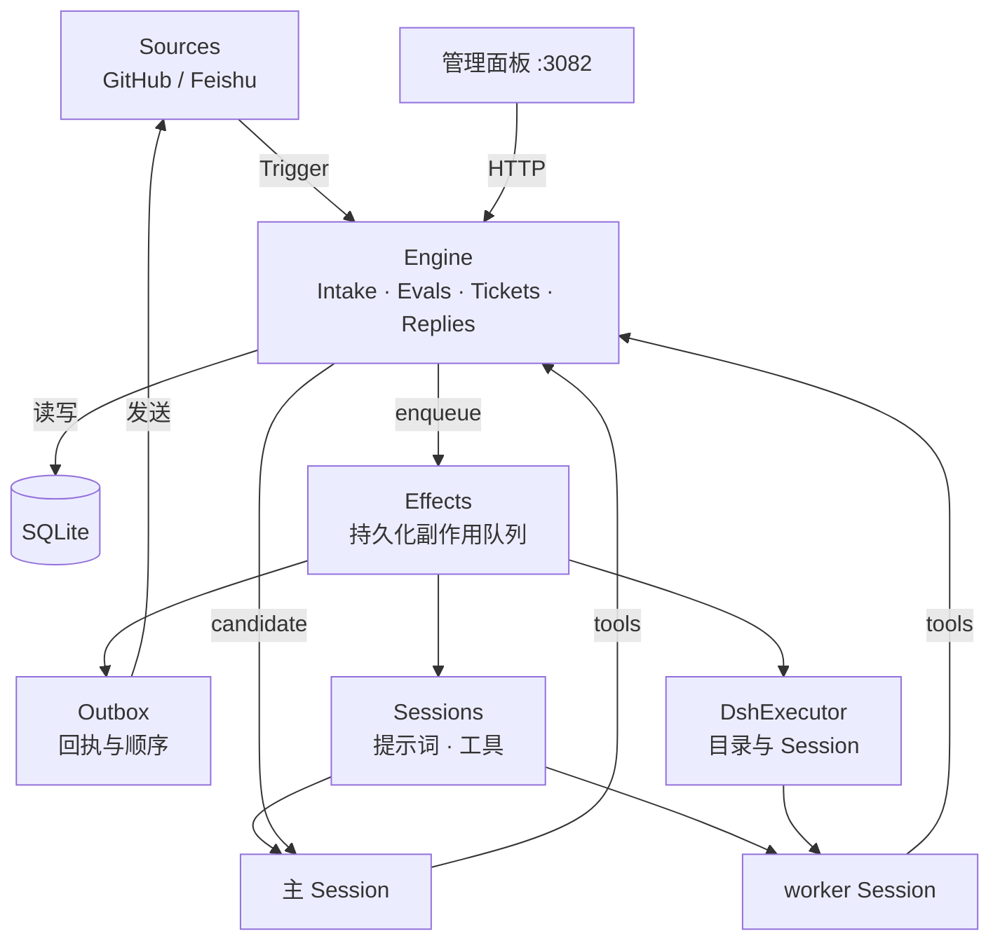
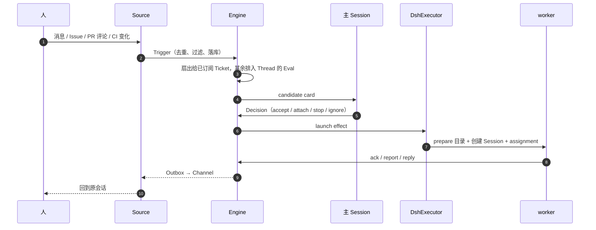
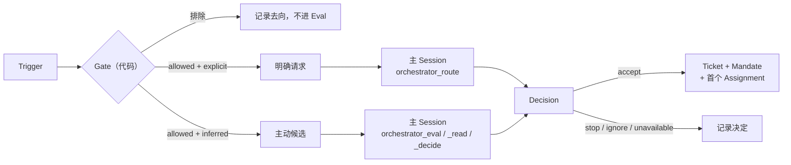
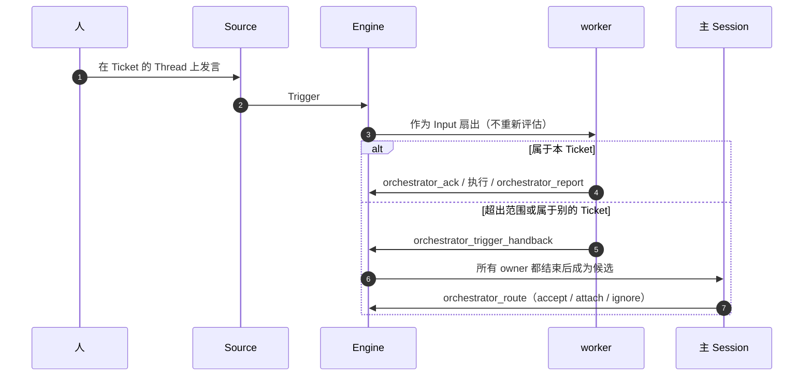
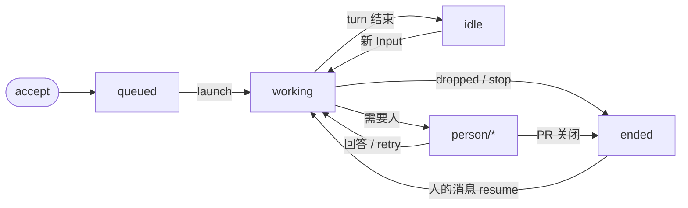
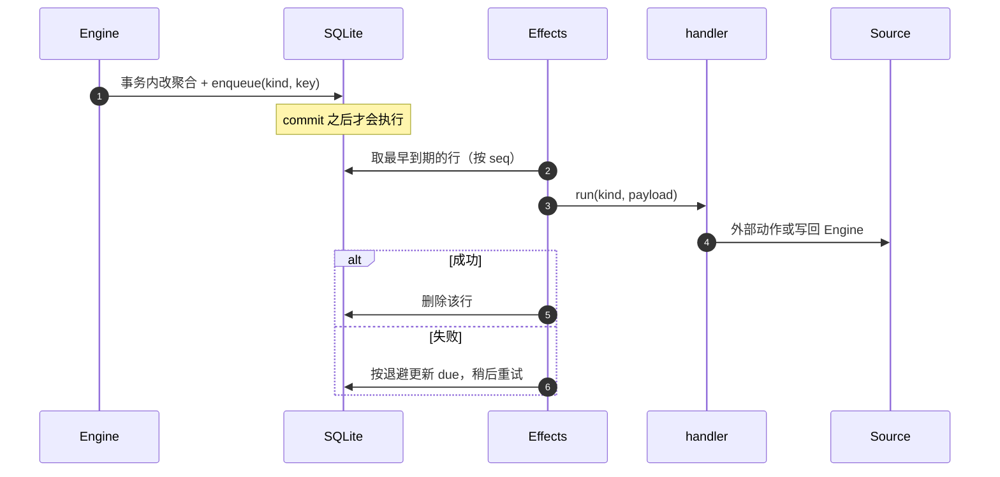
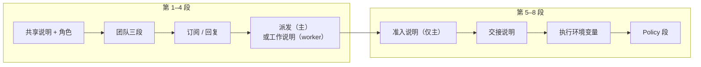

# Superagent 工作原理与调用链路

> 说明 dsh-superagent 大致的运行原理，以及一条请求从触发到交付经过的调用链路。整理自 `dsh-superagent` 原型（v0.1.0，DeepSeek Harness 0.2.x）；更细的领域规则见原型仓库 `docs/001-domain.md`～`docs/007-architecture.md`。文中**主 Session** 是代码与提示词里的 `orchestrator`，**执行器 Session** 是 `worker`。

## 1. 是什么

dsh-superagent 是跑在 DeepSeek Harness（DSH）里的主动式（proactive）编码 agent，以 DSH bundle 形式部署。它盯一个 GitHub 仓库，可选再加一个飞书 Bot：有人（或已启用的规则）提出请求后，它把请求变成 **Ticket**，在专属 Session 和目录里执行，完成后回到原会话交付 PR 或消息。设计原则是**尽量少占用人，尽量多给价值**。

## 2. 运行形态

| 层 | 说明 |
| --- | --- |
| 进程 | 一个独立的 DSH profile（本机 `superagent`）常驻运行；管理面板是本地 HTTP 服务（本机 `http://127.0.0.1:3082`） |
| 插件 | `dsh-superagent` bundle 插入主插件、`github-watch`、`feishu-watch`（默认关闭），并注册两个 agent preset |
| 状态 | `stateDir` 下一份 SQLite（`orchestrator.sqlite`）；Ticket 目录默认 `stateDir/work`；`worker-bin/` 放 `gh`、`lark-cli` 包装器，旁边是 agent 的 git 配置 |
| 主 Session | `dsh-superagent-router` preset，id `orchestrator-<stateDir 摘要>`；只路由和评估，不做技术判断 |
| 执行器 | 每个 Ticket 一个 `dsh-superagent-worker` Session（id `worker-<ticketId>`）和目录；前台命令 5 秒转后台 job，便于随时接消息 |
| 子代理 | worker 派生的 subagent 使用 DSH `standard` preset |

### 组件关系

## 3. 领域对象

| 概念 | 中文 | 要点 |
| --- | --- | --- |
| Source | 来源 | 事件流：GitHub 通知 / Issue / PR / CI，飞书事件与历史；负责去重、过滤，把事件翻译成 Trigger |
| Thread | 线程 | 一个话题或 PR 下的 Trigger 序列；同一 Thread 的 Eval 串行，期间到达的合并成下一批 |
| Trigger | 触发 | 一条不可变事件；同 id 只落库一次，重复接单只会产生一个 Ticket |
| Policy | 策略 | 版本化准入规则：哪些人 / 机器人能在哪个 Source 提需求，以及主动模式的规则 |
| Eval | 评估 | 两层：Gate（代码，确定性准入）+ Assessment（模型研判，仅主动候选）；产出 Decision |
| Decision | 决定 | accept 接单 / stop 停止 / ignore 忽略 / unavailable 未完成 |
| Mandate | 授权 | accept 授予的范围、强度与 Policy 版本；不可变，只有人的 stop 或 Policy 失效会撤销 |
| Ticket | 工单 | 授权工作的单元；生命周期 open → ended，人的后续消息可 resume |
| Subscription | 订阅 | Ticket 与 Thread 的多对多关系；后续消息无需再次 @ 就能到达执行者 |
| Assignment | 派工 | Ticket 与一次执行器运行的绑定；pending → running → ended |
| Input | 输入 | 送给 Ticket 的上下文：扇出的 Trigger、Policy 变更、resume、文本备注 |
| Report | 报告 | 执行器回给 Ticket 的状态：progress / waiting / ready / blocked / failed / dropped |
| Channel / Outbox | 渠道 / 发件箱 | 回复的写侧；对外消息先入 Outbox，再按顺序发送并记录回执 |

## 4. 端到端调用链路

### 4.1 触发

- GitHub Source 轮询通知、Ticket 关注的 Issue/PR 及其 CI；飞书 Source 消费实时事件，并恢复历史、轮询已订阅话题。
- 事件先由 Source 完成去重、过滤和身份校验，再翻译成带 `source`、`id`、作者和定位信息的 Trigger。
- `Engine.receive` 把 Trigger 存一次（幂等），记录去向（disposition），再扇出到其 Thread 上所有订阅中的 Ticket。

### 4.2 评估与决策

- Passes 每 2 秒跑一次 `evaluateDue`，也接受命令即时触发；一个 Thread 同时只有一个 Eval。
- **Gate** 是纯代码：判断来源身份是否允许、强度是 `explicit`（点名请求）还是 `inferred`（规则推断）。
- **Assessment** 只针对主动候选：`assessment` effect 把 candidate card 送进主 Session，主 Session 用 `orchestrator_eval` 读有界窗口、`orchestrator_eval_read` 补读消息/图片/仓库文件，再用 `orchestrator_eval_decide` 提交判断。Eval 默认 120 秒超时，超时重排两次，第三次记 `unavailable`。
- **明确请求**走另一条路：卡片以 `explicit` 到达主 Session，主 Session 用 `orchestrator_route` 批量决定 accept / attach / stop / ignore，不读代码、不做实现计划。
- `accept` 在工具调用里完成：Engine 在**一个事务**内创建 Ticket、Mandate、订阅、首个 Assignment 和确认回复；`attach` 则把消息挂到已有 Ticket 并结束当前 Eval。

两条路径合起来是：

### 4.3 派工与执行

- Runtime 启动时恢复被中断的 Assignment；新 Assignment 经 `launch` effect 排队。
- `DshExecutor` 先跑 `prepare` 命令（默认不跑，超时 10 分钟），通常用 `git worktree` 从本地克隆建出 Ticket 目录；prepare 失败直接让 Ticket `failed`。
- 随后创建（或复用）执行器 Session，发送 assignment：Ticket 执行文本、路由说明、执行环境变量，以及当前 Policy 的匹配规则。
- 执行器按 DSH 的 agent loop 工作：读仓库、改代码、跑测试、用 `gh` 开 PR、用 `lark-cli` 回飞书；长命令自动转后台 job，不阻塞接收消息。
- 并发由 worker 槽位控制（默认 3 个）；人的消息可多占 1 个槽位，避免新工单挡住已有工单的沟通。
- 一轮结束后后台工作最多再跑 30 分钟；到点杀掉 shell job 并报 `waiting`，subagent 可以继续。

### 4.4 汇报与回复

- `orchestrator_report` 写入 Report 和可选的 `human_action`：progress 一般只留在 Ticket 内部；其余状态（ready、blocked、failed 等）和带 `human_action` 的报告经 relay effect 转给主 Session，`dropped` 同时结束 Ticket。
- `orchestrator_ack`、`orchestrator_reply` 调 `Engine.reply`，在事务里写 Outbox 回执并入队 `reply` effect，发送成功后回执落定。同一 Ticket 对同一会话按队列顺序发，失败从 5 秒起倍增退避到 300 秒。
- 渠道是 Source 的 Channel：GitHub 评论、review thread 回复、飞书话题回复。飞书有 100 词上限；会话消失时消息记为 `dropped`，不反复重试。
- 主 Session 不发普通进度，只在中继「结果可看 / 需要人决定 / 做不了」时发一条短消息。

### 4.5 交付与收尾

- worker 在 Report 里带 `pr_number`，或由 GitHub Source 发现，Ticket 绑定该 PR 的 Thread；PR 的 CI 与 review 反馈直接作为 Input 回到 worker。
- PR merge/close 由 Source 报给 Engine：当 Ticket 打开或跟随的 PR 都关闭，且没有未完成的 resume、retry 或未处理的 follow-up 时，Ticket 结束（`merged` 或 `closed`），并向聊天渠道补一条收尾通知。
- 自动合并由提示词的 Delivery requirements 约束，宿主没有合并逻辑：PR 就绪、改动少于 200 行、所需批准覆盖 head commit 时才启用，否则由人合并。
- 人在已结束 Ticket 的 Thread 上再发言会直接 resume（沿用原 Mandate，不再走 Eval）；bot 与 CI 不会唤醒它。

### 4.6 人的跟进

- 人的消息到达时先扇出到订阅 Ticket（不重新评估）：该 Ticket 的 worker 判断是否属于自己——属于就做并确认，超出范围用 `orchestrator_trigger_handback` 交还。
- 等所有 owner 都交还或结束后，消息才回到主 Session 成为候选；主 Session 对 follow-up 只能 stop，不能替 worker 接活。
- 主 Session 可用 `orchestrator_ticket_note` 传一条事实（不超过 100 词），但备注不授予权限。

## 5. 工具与 Engine 方法对照

| Session | 工具 | 落到 | 效果 |
| --- | --- | --- | --- |
| 主 | `orchestrator_route` | `Engine.decide` / `attach` / `stopTicket` | 一次批量路由 1–20 个候选 |
| 主 | `orchestrator_eval*` | `MasterAssessor.context/read/decide` | 主动候选的只读研判与决定 |
| 主 | `orchestrator_reply` | `Engine.reply` | answer / result / attention 三种用途 |
| 主 | `orchestrator_ticket_note` / `request_status` / `retry` | `Engine.note` / `requestStatus` / `retryTicket` | 给执行器事实、催状态、重试 |
| 主 | `orchestrator_read`、`thread_*`、`settings`、`prompts` | 只读资源与设置 | 面板同等操作 |
| worker | `orchestrator_read` | `readResource` | 读 ticket / input / trigger 分页 |
| worker | `orchestrator_ack` | `Engine.reply(acknowledgement)` | 回原消息确认，硬上限 100 词 |
| worker | `orchestrator_report` | `Engine.report` | 报告状态、提问、绑定 PR |
| worker | `orchestrator_thread_follow` / `unrelated` / `trigger_handback` | `followForContext` / `markUnrelated` / `handback` | 管理订阅并交还越界请求 |

## 6. 持久化、并发与恢复

- SQLite 表：`trigger`、`trigger_thread`、`thread`、`ticket`、`decision`、`disposition`、`outbox`、`effect`、`kv`；schema 11，旧库启动时迁移。
- `Effects` 是持久化副作用队列：`assessment`（候选投递）、`launch`（派工）、`delivery`（补充输入）、`relay`（转主 Session）、`notice`（静默通知）、`reply`（发送消息）。事务内入队、提交后执行，失败指数退避，每类有独立健康状态。
- 一条命令一个事务；Engine 是 Trigger、Thread、Decision、Ticket 的唯一写入者，Source 只能通过 `SourceContext` 改自己的元数据。
- 重启后 Session、目录、订阅、待发消息和已读记录都保留；运行中的 Assignment 带恢复说明重跑，等待人的照旧等待。
- 暂停会停掉派发、新评估、超时和回复，但 Source 继续记录、正在跑的 turn 不打断；恢复后 Eval 截止时间顺延暂停时长。

### Ticket 阶段

`person/*` 包含 `review`、`answer`、`blocked`、`failed`、`delivery` 五个子阶段，由最新 Report 和输入投递决定（见第 8 节）。人的 `stop` 可以从任何阶段结束 Ticket；已结束的 Ticket 收到人的消息会沿用原 Mandate 恢复，bot 与 CI 的消息不会。

### 副作用队列

## 7. 提示词与授权边界

强弱顺序固定，提示词改不了代码强制的部分：

1. 工具与宿主强制：身份、权限、参数校验、回复用途与长度，改不了。
2. 内置与生成段：角色、订阅、回复、派发/工作、交接，以及每次请求重新生成的 Policy 段。
3. 团队覆盖：Communication、Ticket scope、Delivery requirements 三段加团队技能。
4. 外部文本：消息、评论、文档、引用，只是数据，永远不改变规则。

每次请求的提示词按固定顺序拼装：

每次模型请求都绑定当前提示词版本；保存提示词不重启、不打断 Session，执行器可以读回自己用过的版本。

## 8. 在本机看一条链路

- 面板 `http://127.0.0.1:3082` 的标签页：Overview（谁在等人）、Source、Trigger、Eval、Execution（Ticket 列表与阶段）、Settings（Source / Eval / Execution / Prompts / Deployment）。
- Ticket 阶段一眼可判：`working` 干活中、`idle` 等待触发、`person/review` 等 review、`person/blocked|failed` 等人处理、`person/delivery` 输入没送到、`person/answer` 等回答。
- 直接查库 `sqlite3 stateDir/orchestrator.sqlite`，按 `trigger` → `decision` → `ticket` → `outbox` 看一条请求的完整轨迹。
- Ticket 目录在 `stateDir/work/<short-name>-<ticketId 前 12 位>`；执行器 Session 在 DSH 里搜 `worker-<ticketId>`。
- 健康：面板 Overview 的系统问题，以及 `scripts/dsh-superagent status` 的退出码（0 正常、1 运行异常、2 某部件报错、3 等待 setup）。

## 9. 六步小结

Source 产生 Trigger → Gate 与 Assessment 决定接不接（Decision）→ 接单生成 Ticket + Mandate → `launch` 起一个执行器 Session 在独立目录干活 → `orchestrator_report` 把结果写回 Ticket、必要时 relay 给主 Session → `reply` 经 Outbox 与 Source 回到原会话；PR 关闭或工作完成即结束，人的后续消息可以再唤醒。
